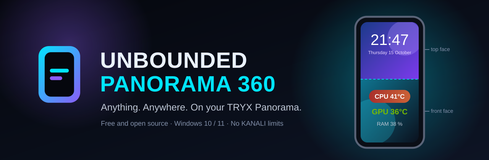
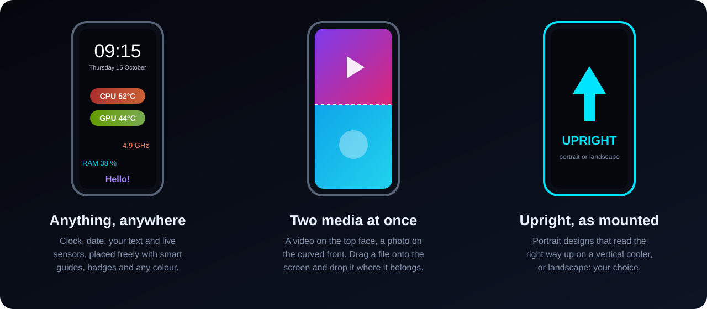

<p align="center">
  
</p>

<p align="center">
  <a href="https://github.com/UnboundedTechnologies/Unbounded-Panorama-360/releases/latest"></a>
  
  <a href="LICENSE"></a>
  
</p>

<h3 align="center">Your cooler has a gorgeous curved AMOLED screen. Use all of it.</h3>

<p align="center">
  <b>Unbounded Panorama 360</b> is the free, open source studio for TRYX Panorama coolers.<br>
  Put live temperatures, clocks, your own text, photos and videos <b>anywhere</b> on the screen,<br>
  upright on a vertical cooler, with a different image on the top and on the curved front.
</p>

<p align="center">
  <a href="https://github.com/UnboundedTechnologies/Unbounded-Panorama-360/releases/latest"><b>⬇ Download the installer</b></a>
  &nbsp;·&nbsp; <a href="#everything-it-does">See what it does</a>
  &nbsp;·&nbsp; <a href="#open-source">It is open source</a>
</p>

---

## Why you will love it

The official KANALI app gives you **three metrics in fixed slots, horizontally only**. Mount your cooler vertically and everything reads sideways. The screen can do far more than that, and now it does:

| | KANALI | **Unbounded Panorama 360** |
|---|:---:|:---:|
| Where values can go | 3 fixed slots | **Anywhere, up to 24 elements** |
| Vertical (portrait) cooler | Horizontal only | **Upright, as mounted** |

And on top of that: control of every RGB device in your PC, a different photo or video on the top and on the curved front, your own text with badges in any colour, YouTube import in the best available quality, free drawing, presets, a live video preview and a media library. **All free and open source.**

<p align="center">
  
</p>

## Everything it does

### 🎛️ A real design studio
- **Drag anything anywhere**: CPU and GPU temperature, load, clocks, power, fans, RAM, drives, network, plus clock, date and your own text.
- **Smart guides** like your favourite design tool: magnetic snapping, alignment, equal spacing, centring, multi-select, undo and redo.
- **Style it your way**: four font weights, any size, a full colour picker with quick and recent colours, gradient badges.
- **Free drawing** with pen, lines, rectangles and ellipses, right on the screen.
- **Presets**: save your designs, switch between them in one click, start from ready-made templates.

### 🖼️ Photos and videos, done right
- **Two media at once**: a video on the flat top face and a photo on the curved front, or one image across the whole screen.
- **Drop it where it goes**: drag a file over the window and the screen lights up its top, middle or bottom, like snapping a window in Windows.
- **Exact placement**: move and zoom the background with the mouse, snap it to the edges or the centre, or type exact pixels.
- **YouTube import**: paste a link, pick the moment and the length, and it downloads in the best quality YouTube offers.
- **See it move**: the editor plays your video exactly as the cooler will, and the library previews every clip.

### 🌈 All your RGB in one place
- **Every RGB device of every major brand** in one ARGB tab: motherboard and its ARGB headers, RAM, graphics card, fans, keyboards and more, detected through the free OpenRGB service.
- **Sync everything to one look** in one click, or give each device and zone its own effect, colour, speed and brightness.
- **Animated effects everywhere**: Rainbow, Spectrum Cycle, Breathing and Flashing also run on devices without built-in effects (such as Wooting keyboards), drawn live by the app.
- **Unplug and replug freely**: a keyboard or any device plugged back in gets your lighting again within seconds.
- **Checked, not assumed**: after start-up, sleep or a device change, the app reads every device back to make sure it really shows your settings, and repairs OpenRGB by itself when one does not. The page never shows "synced" for a device that is not.
- **Every effect really applies**: Static, Off, Breathing and the rest reach the device even where OpenRGB 1.0 used to ignore them silently.
- **Fan hubs and LED strips on ARGB headers**: set how many LEDs are connected, name the header, and they join in.
- **Profiles** to switch looks, restored automatically at start-up and after sleep, and saved into devices that have memory for it.
- **Replaces Armoury Crate's lighting** with one click (the rest of Armoury Crate stays).

### ⚡ Fast and invisible
- **Opens in about a second**, with no UAC prompt, and can start with Windows straight into the tray.
- **Prepares your design in the background** while you edit, so pressing Apply usually only uploads.
- **Uses your NVIDIA GPU** to convert video when you have one, at higher quality and about twice as fast.
- **Live values update every second** on the cooler, without re-sending your design.
- **Cleans up after itself**: old conversions are deleted automatically, only what is useful is kept.

## Get it

1. **Download** `UnboundedPanorama360-Setup-<version>.exe` from the [latest release](https://github.com/UnboundedTechnologies/Unbounded-Panorama-360/releases/latest).
2. **Close KANALI** (only one program can talk to the cooler at a time).
3. **Run the setup.** It installs everything it needs, only if missing: FFmpeg for video, yt-dlp and Deno for YouTube, the PawnIO driver for CPU temperature, clocks and power, and OpenRGB for the ARGB tab. .NET is included.

Windows SmartScreen may say the publisher is unknown, because the installer is not code-signed. Click **More info**, then **Run anyway**.

Updating is just as easy: run a newer setup and it updates in place, keeping your designs, presets and library. Uninstall any time from Windows Settings, Apps.

## Open source

Unbounded Panorama 360 is **free and open source** under the [MIT license](LICENSE). Every line of code is right here: read it, build it, change it, share it.

- **No account, no telemetry, no ads.** The app talks to your cooler over USB and to nothing else (except YouTube and winget when you ask it to).
- **Contributions are welcome.** Found a bug, have an idea, own a Panorama SE or WB? Open an [issue](https://github.com/UnboundedTechnologies/Unbounded-Panorama-360/issues) or a pull request.
- **Tested**: 50 automated tests cover layout, snapping, video conversion and the two-media composition.

### Build it yourself

You need Windows and the .NET 10 SDK.

```powershell
winget install Microsoft.DotNet.SDK.10 JRSoftware.InnoSetup
dotnet build -c Release              # the app
dotnet test -c Release               # the tests (FFmpeg needed for the video ones)
.\build-installer.ps1                # the setup, in dist\
```

A read-only hardware probe is included for curious minds (close KANALI first):

```powershell
dotnet run -c Release --project tools/Unbounded.Panorama.Probe -- .\probe-output
```

## Under the hood

The cooler appears to Windows as a USB printer-class device bound to the in-box `usbprint.sys` driver. The app opens its `GUID_DEVINTERFACE_USBPRINT` interface with overlapped `ReadFile`/`WriteFile`: **no driver replacement, no Zadig.** Messages are `"TRYX"` + a little-endian `uint32` length + a protobuf message (see `src/Unbounded.Panorama.Core/Protocol/panorama.proto`).

Your design becomes two things: an **overlay** of text groups the cooler's firmware draws itself (so live values are cheap to update) and **one H.264 video** for the background, which FFmpeg composes from your photos, videos and drawing.

RGB goes through the OpenRGB service on `127.0.0.1:6742`. The app works around two OpenRGB 1.0 bugs, both confirmed in its source and on hardware:
- **Modes without a direction** (Static, Off, Breathing…) are reported with direction `0xFFFFFFFF` but only accepted with `0`, and a request with the reported value is dropped without an error. The app sends mode changes itself with the value OpenRGB accepts.
- **A device detected again while OpenRGB runs** (unplugged and plugged back in, or after a rescan) gets a new internal ID that OpenRGB then checks as a list position, so every command for it is dropped while it stays listed (fixed in OpenRGB 1.1). The app listens for OpenRGB's device-list notice, reads every device back after re-applying, and restarts the service when a device ignored its settings: again after each replug, otherwise at most once every 10 minutes and 3 times an hour. Each step is written to `lighting.log`.

The app needs administrator rights because CPU sensors are read through a kernel driver (like HWiNFO). It still never shows a UAC prompt once installed: setup registers two scheduled tasks with highest privileges, one the shortcuts use and one for "Start with Windows".

| USB ID | Model | Status |
|---|---|---|
| `391a:1011` | Panorama | Verified on hardware |
| `391a:1021` | Panorama SE | Same protocol family, untested |
| `391a:1031` | Panorama WB | Same protocol family, untested |

## Credits

Protocol knowledge comes from the clean-room research in [DXVSI/Tryx-Linux-GUI](https://github.com/DXVSI/Tryx-Linux-GUI) (MIT). RGB devices are driven through [OpenRGB](https://openrgb.org) (GPL-2.0, installed separately as its own service, not bundled) using [OpenRGB.NET](https://github.com/diogotr7/OpenRGB.NET) (MIT). Unbounded Panorama 360 is an independent Windows implementation and is not affiliated with TRYX or KANALI.

## License

[MIT](LICENSE) © 2026 Unbounded Technologies. Free to use, modify and share.

<p align="center"></p>
